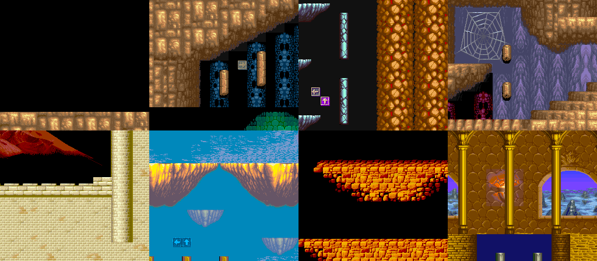

# Black Tiger AGA

A port of Capcom's *Black Tiger* (1987 arcade) to the Amiga 1200, aimed at a
**stock A1200 (68020 @ 14 MHz, 2 MB chip RAM, no fast RAM)**.

This repository contains **no Capcom data**. Every graphic, map and palette is
converted at build time from your own MAME ROM set (`blktiger.zip`, the parent
set). Please don't distribute the built disk images.

## Status

| Part | State |
|---|---|
| ROM loading and CRC check, graphics decoding (tiles, sprites, text) | done |
| Level maps and palettes extracted straight from ROM (all 8 levels) | done |
| AGA scrolling engine: 8 bitplanes, 256 colours, 50 fps 2-way scrolling | done, pixel-exact against a reference render |
| Main game code: Z80 → 68020 translator and runtime | working: 3,000 frames of attract mode and play match MAME byte for byte (see [docs/TRANSLATOR.md](docs/TRANSLATOR.md)) |
| Translated game on the A1200: background, sprites, text layer, palette, joystick, keyboard | working (`build/blacktiger.adf`): game logic at full speed; the display drops to 25 fps on busy screens |
| Game sprites (player, enemies, shots) | done: blitter objects, double buffered; matches a MAME-style reference render |
| Background priority (scenery in front of sprites) | next |
| Code coverage of later levels | in progress: code the recordings never reached stops with a red screen |
| Sound | planned |
| WHDLoad/HD install | planned |

See [docs/PLAN.md](docs/PLAN.md) for the analysis, the stock-A1200 budget and the roadmap.



## Building (Windows, macOS or Linux)

You need:

* **Python 3**: the build uses only the standard library.
* **vasm** (`vasmm68k_mot`): either on your PATH or set `VASM` to its full path.
  Windows binaries: http://sun.hasenbraten.de/vasm/ (Motorola syntax, m68k).

Then:

```
copy your blktiger.zip into roms\
python tools/build.py            (all 8 levels)
python tools/build.py --level 3  (just one)
```

The disk images are written to `build/viewer_level1.adf` … `viewer_level8.adf`.

The translated game itself:

```
python tools/build_game.py       -> build/blacktiger.adf (60 Hz, like the arcade)
python tools/build_game.py --pal -> 50 Hz version
```

Memory: a stock A1200 (2 MB chip RAM) is enough: the game takes about 1.85 MB.
With fast RAM (about 1.2 MB free, e.g. any 4 MB expansion) the program and the
arcade's memory go there and only the graphics stay in chip RAM, which makes
the busy scenes noticeably smoother. The same disk does both, automatically.

The default disk switches the A1200 to NTSC timing (60 Hz, 262 lines), the
arcade's own frame rate: the game runs at the original speed. That needs a
display that accepts 60 Hz (any 15 kHz arcade monitor or most TVs; WinUAE
handles it). The `--pal` disk stays at 50 Hz, so the game runs at 5/6 speed.

Controls: joystick in port 2 (fire = attack, second button or Space = jump,
or cursor keys / Ctrl), keyboard **5** = coin, **1** = 1 player start,
**2** = 2 players. Not there yet: sound, and scenery drawn in front of sprites
(sprites currently always appear on top).

If the screen turns red with "UNKNOWN Z80 CODE / BANK xx AT xxxx", the game
reached Z80 code the translator hasn't seen yet: please report those numbers
and where it happened.

## Running in WinUAE

1. Quickstart: model **A1200**, configuration **"Basic non-expanded A1200"** (2 MB chip, no fast RAM: the target machine). A Kickstart 3.x ROM is best; WinUAE's built-in AROS ROM also boots it.
2. Put `build/viewer_levelN.adf` in DF0: and start.
3. Joystick in port 2 scrolls the map; hold fire to scroll faster. If you leave
   it alone for two seconds it pans around by itself.

## Layout

```
src/boot.s            bootblock: loads the program into chip RAM
src/viewer.s          AGA level viewer (display engine, milestone 1)
tools/bt_rom.py       ROM set loading and graphics decoding (from MAME's driver)
tools/bt_level.py     level maps, palette scripts, tile layouts
tools/convert_level.py  level -> Amiga palette / 8-bitplane tiles / map
tools/mkadf.py        bootable ADF writer
tools/build.py        one-command build
tools/preview.py      PNG sheets of the ROM graphics (needs Pillow)
tools/render_ref.py   reference render used by the screenshot tests (needs Pillow)
tools/mame/*.lua      MAME scripts used to measure the arcade game
tools/test/           FS-UAE screenshot test harness
tools/z80/            Z80 decoder, code map, timing table and the translator
src/rt_core.s         runtime for the translated game (scheduler, banks, I/O)
src/harness_main.s    test build of the translated game
src/amiga_main.s      the A1200 build: interrupts, inputs, display (background, sprites, text, palette)
tools/convert_game.py graphics for the A1200 build
tools/build_game.py   one-command build of build/blacktiger.adf
tools/harness/amiga_sim.*     runs the A1200 build on Musashi (speed, memory dumps)
tools/harness/render_frame.py draws a frame from such a dump, following the copper list
tools/harness/render_arcade.py draws the same frame the way MAME does, and compares
tools/lzpack.py       packer for the disk data (unpacked at boot)
tools/harness/        68k test harness (Musashi) that checks the translation against MAME
data/code_entries.txt Z80 code addresses seen running in MAME (addresses only)
```
